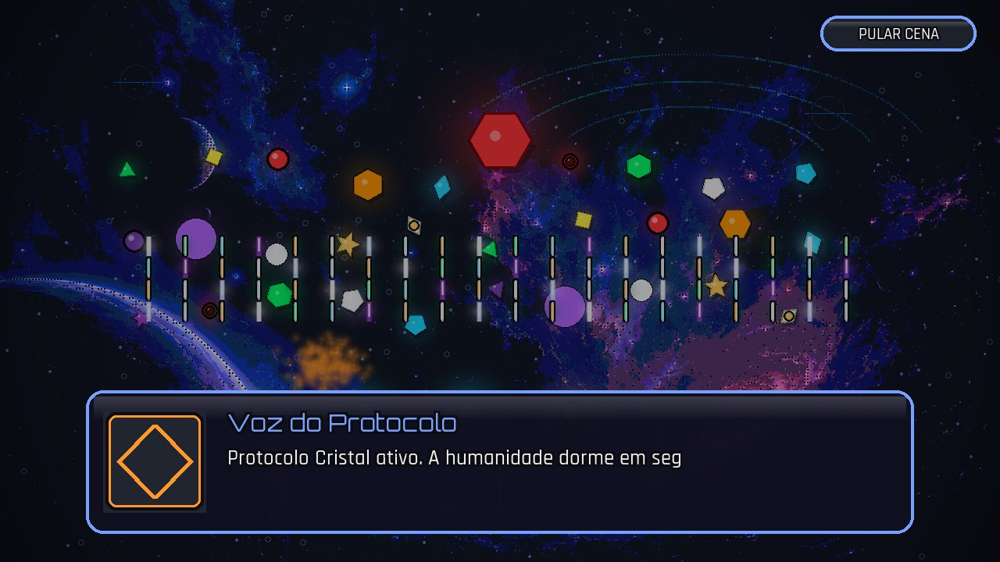
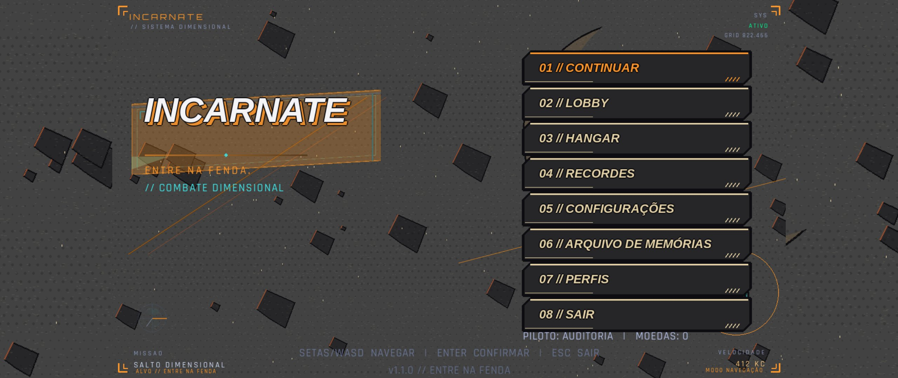
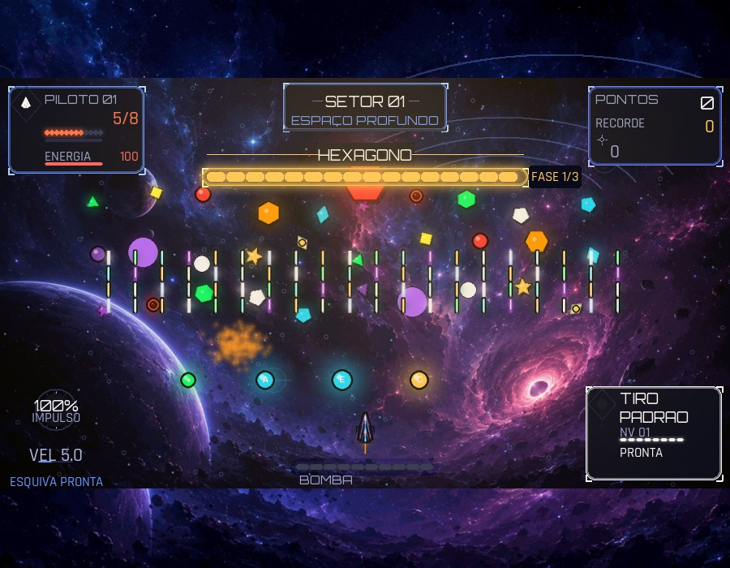

# INCARNATE 

Shoot 'em up vertical em **Pygame** com progressão, personalização de nave,
6 dimensões, inimigos especiais e entidades RIFT (bosses). O código é 100%
procedural (visual, sons e música são gerados em runtime, sem assets
externos).

## Windows e Linux

Baixe a versão para Windows em [Releases](../../releases). Em cada versão,
`VOID-SHIFT-Setup.exe` instala o jogo com atalho e desinstalador; `VOID-SHIFT.exe`
é a opção portátil. Não é necessário abrir o GitHub Actions. Builds de teste
continuam disponíveis como artefatos do workflow **Executáveis Desktop**. Veja
as instruções de [distribuição para Windows](docs/distribuicao-windows.md).

No Linux, a mesma Release inclui `VOID-SHIFT-Linux-x86_64.tar.gz`. Extraia o
arquivo e abra `VOID-SHIFT/VOID-SHIFT`. O formato de pasta autocontida reduz o
tempo de abertura e evita depender da extração em diretórios temporários. Builds
de teste e instruções locais estão em
[distribuição para Linux](docs/distribuicao-linux.md).

Os dois pacotes são gerados no mesmo workflow e no mesmo commit. Os arquivos
`BUILD-COMMIT-Windows.txt` e `BUILD-COMMIT-Linux.txt` permitem confirmar que
as distribuições contêm exatamente a mesma versão do jogo.

> Este README é orientado a **desenvolvedores e IAs**: explica a arquitetura,
> o fluxo de dados e as convenções para que qualquer pessoa (ou modelo) possa
> navegar, modificar e estender o código com segurança.

---

## Sumário

1. [Como executar](#como-executar)
2. [Arquitetura](#arquitetura)
3. [Fluxo do jogo](#fluxo-do-jogo)
4. [Modelo de dados](#modelo-de-dados)
5. [Convenções do código](#convenções-do-código)
6. [Performance](#performance)
7. [Como estender](#como-estender)
8. [Testes](#testes)

---

## Como executar

```bash
python -m pip install -e ".[gpu]"           # Linux ou Windows
python main.py
```

Sem aceleração OpenGL, instale apenas com `python -m pip install -e .`; o jogo
usa automaticamente o renderizador de CPU e os perfis de desempenho.

Em **Configurações**, o acabamento comic da GPU permite ajustar intensidade,
contorno, quantidade de tons, hachuras, grão e saturação. A opção **Preservar
interface** mantém HUD e textos fora do filtro e vem ligada por padrão.

Sem áudio/vídeo (CI, servidores, debugging):

```bash
SDL_VIDEODRIVER=dummy SDL_AUDIODRIVER=dummy python main.py
```

### Mira e disparos (1.2.0)

Durante a partida, o cursor do sistema dá lugar à mira da dimensão atual.
Mova o mouse para apontar e segure o botão esquerdo para atirar. Espaço, Z e a
tecla configurada continuam disparando. Com **Configurações → Mira customizada**
desligada, ou com o mouse fora da área do jogo, o teclado mantém o disparo
vertical anterior. Menus, pausa e seleção de equipamento usam o cursor normal.

A mira pulsa quando ocorre um disparo e fica vermelha sobre a hitbox de um
inimigo. **F3** alterna FPS, estado e velocidade do avanço, camadas e partículas
ativas, posição da mira e hitboxes durante a partida.

A nave equipada também gira para acompanhar a mira. Cada uma das dez skins
gera 48 sprites direcionais a partir da própria arte, mantidas em cache; as
animações de transparência, cristal, asas e relâmpagos preservam seus quadros.
O tilt de movimento se soma à direção. A hitbox permanece fixa e, com a mira
desligada ou fora da área do jogo, o desenho original volta a ser usado.
[Prévia das dez skins em quatro direções](images/preview_naves_mira.png).
Para regenerá-la: `python -m tools.preview_naves_mira` (use `--estilo COMIC`
para uma prévia do outro perfil).

Disparos direcionais saem da nave na direção exata da mira. **Duplo** e
**Espiral** orientam sua dispersão ao redor dessa direção, então os projéteis
individuais se afastam do ponto central. **Limitação conhecida:** o **Íon**
continua sendo uma coluna vertical fixa na posição da nave; apontar a mira
não altera sua trajetória. Ajuste `dispersao_duplo_graus` (padrão `4.5`) e
`dispersao_espiral_graus` (padrão `15.0`) no `settings.json` do diretório de
dados do usuário para balancear o leque. `mira_ativa` fica no perfil selecionado;
configurações antigas são copiadas na migração e novos perfis recebem `true`.

### Perfis de jogador (1.5.0)

Ao abrir o jogo, selecione um perfil antes do menu principal. **N** cria um
perfil; as setas escolhem outro, Enter seleciona, **R** renomeia e Delete pede
confirmação digitando exatamente o nome exibido. O mouse também seleciona os
cartões e botões. No menu principal, **Perfis** permite trocar de jogador fora
de uma partida. O perfil em uso não pode ser excluído durante o combate. Se
todos forem removidos, a tela oferece criar outro. A lista mostra moedas,
armas, skins, dimensão, bosses e último acesso; um perfil ilegível aparece
como **DANIFICADO**, sem impedir o acesso aos demais.

Cada perfil tem UUID e um arquivo `profiles/<uuid>.json` com cópia `.bak` no
diretório de dados do jogo. `profiles/index.json` guarda a lista, o último
perfil usado e o marcador de migração; se sumir ou estiver corrompido, o jogo
o reconstrói pelos arquivos de perfil. No primeiro uso, o `save.json` e o
`records.json` antigos são importados para **JOGADOR** e preservados sem novas
gravações. O nome pode ser editado depois. A seleção usa controles padrão
antes de carregar um perfil. Uma gravação que falhe deixa a alteração pendente
em memória; o jogo avisa na tela e o F3 mostra perfil, ID curto, última
gravação e pendência.

Para verificar na prática, defina `INCARNATE_DATA_DIR` para uma pasta de teste
e execute `python main.py`. Crie dois perfis, ganhe ou gaste moedas no primeiro,
troque pelo menu e confirme que o segundo começa sem esse progresso. Renomeie
e exclua um perfil pela tela de seleção. Para testar migração, copie um
`save.json` antigo para essa pasta antes de iniciar; para recuperação, altere
o conteúdo de `profiles/<uuid>.json` para `{` e mantenha o `.bak` válido.
Corrompa também o `.bak` para ver o aviso de perfil danificado. Faça esses
testes em cópias dos arquivos, preservando os dados pessoais.

`limite_perfis` (padrão 5, intervalo 1–20) e `limite_nome_perfil` (padrão 16,
intervalo 1–32) são ajustáveis em `settings.json`. Controles remapeados,
sensibilidade e `mira_ativa` ficam em cada perfil; volume, vídeo, qualidade
visual e velocidade do diálogo permanecem globais. Melhorias escolhidas são
contadas por perfil, mas seus efeitos terminam ao fim da partida.

### História e cutscenes (1.4.0)

A introdução e o capítulo 1 são reproduzidos durante a partida. O roteiro
pt-BR fica em `src/runtime/story/cenas_pt_BR.json`; o motor lê gatilhos e
passos sem manter falas no código. Os capítulos seguintes aguardam revisão do
capítulo 1. O nome mostrado nas cenas vem de `NOME_JOGO` em
`src/core/constants.py` e atualmente é **INCARNATE**.

A tecla remapeada de **atirar**, Enter ou clique avança a fala; o primeiro toque
completa o texto instantaneamente. **P** ou Esc pausa e retoma a cena.
**Backspace** segurado por 0,65 s ou o botão **Pular cena** abre confirmação.
Cenas já vistas podem ser puladas com um toque. O progresso só é salvo ao
concluir ou pular; fechar no meio mantém a cena inédita.

Para testar, inicie uma partida: a introdução e a abertura aparecem após o
carregamento. O pré-boss toca quando o HEXAGONO surge no nível 5; o pós-boss e
o encerramento aparecem após sua derrota, antes da retomada do cenário. Em
uma partida de depuração, pressione **F3** e depois **F8** para abrir a lista de
IDs de cenas; setas escolhem e Enter reproduz qualquer uma diretamente. O F3
mostra cena, passo e quantidade de flags vistas. Após desbloquear uma cena,
abra **Arquivo de Memórias** no menu principal para revê-la.

No `settings.json`, `velocidade_dialogo` define os caracteres por segundo:
padrão `42`, aceitando valores de `10` a `120`. Saves antigos recebem
`cenas_vistas: []` em `progresso_campanha` sem perder outros dados.

Os fundos rasterizados das cutscenes recebem posterização, tinta leve da
dimensão, contorno e retícula preparados uma vez e mantidos em cache. Retratos,
caixa e títulos usam contorno escuro de 3–5 px; o magenta fica reservado aos
quadros de glitch e alerta. As camadas do mundo, inimigos e projéteis continuam
desenhados por cima do fundo filtrado.



### Avanço da nave e parallax (1.3.0)

O cenário rola continuamente para baixo, com velocidade própria para cada uma
das seis dimensões. A direção não acompanha o mouse: a mira gira apenas a nave
e os disparos. O fundo ORIGINAL e o COMIC usam tiles repetidos sem emenda, com
três a cinco camadas 2D de velocidades, tamanhos e brilho diferentes. As linhas
de velocidade encurtam durante a frenagem e desaparecem no combate contra um
boss principal. A derrota acelera o cenário de volta e produz um impulso curto.
Minibosses reduzem a velocidade para 50% por padrão. Pausa, melhorias e game
over congelam o avanço; no boss, só as camadas distantes mantêm um desvio leve.

As opções abaixo podem ser editadas no `settings.json` do diretório de dados do
usuário. Configurações antigas recebem os padrões automaticamente:

| Opção | Padrão | Efeito |
| --- | --- | --- |
| `avanco_direcao` | `[0, 1]` | Vetor fixo de rolagem; `[0, 1]` é para baixo. |
| `avanco_velocidades` | `{"1": 120, "2": 135, "3": 105, "4": 115, "5": 145, "6": 125}` | Velocidade base em pixels por segundo. |
| `avanco_qualidade` | `"MEDIA"` | `BAIXA`, `MEDIA` ou `ALTA`: 3, 4 ou 5 camadas. |
| `avanco_camadas`, `avanco_linhas` | `true`, `true` | Liga planos extras e linhas independentemente. |
| `avanco_parada_boss`, `avanco_pico` | `true`, `true` | Liga parada em boss e impulsos de arrancada/salto. |
| `avanco_intensidade`, `avanco_linhas_intensidade` | `1.0`, `1.0` | Escala velocidade e quantidade de linhas. |
| `avanco_freada_s`, `avanco_aceleracao_s` | `1.5`, `1.2` | Duração das curvas em segundos. |
| `avanco_pico_s`, `avanco_pico_intensidade` | `0.3`, `0.25` | Duração e força da arrancada. |
| `avanco_salto_s`, `avanco_salto_intensidade` | `1.0`, `0.5` | Duração e força do salto dimensional. |
| `avanco_desvio_parado` | `0.04` | Fração lenta aplicada às camadas distantes no boss. |
| `avanco_miniboss_percentual` | `0.5` | Velocidade no miniboss: de `0` a `1`. |
| `avanco_miniboss_tipos` | `{}` | Exceções por chave, por exemplo `{"eco": 0.25}`. |
| `avanco_marcos` | `true` | Ativa marcos procedurais de cenário e o destino visual de boss. |
| `avanco_evolucao_paleta` | `true` | Varia cor, brilho e densidade durante o nível. |
| `avanco_ritmo_variavel` | `true` | Liga pequenas variações e passagens visuais. |
| `avanco_marco_tamanho_max` | `420` | Maior lado de um marco em pixels; a qualidade também impõe um teto. |
| `avanco_semente` | `null` | Sorteio por partida; use um inteiro para reproduzir testes. |
| `avanco_ritmo_intervalo` | `8.0` | Intervalo das variações de velocidade, em segundos. |
| `avanco_ritmo_variacao` | `0.08` | Limite da variação de velocidade: `0.08` representa 8%. |
| `avanco_ritmo_passagem` | `2.5` | Duração máxima de uma passagem acelerada, em segundos. |
| `avanco_destino_entrada_s`, `avanco_destino_saida_s` | `1.5`, `1.0` | Duração da aproximação e saída do destino de boss. |
| `avanco_progresso_suavizacao` | `3.0` | Velocidade de interpolação do indicador, limitada de `0.1` a `8`. |

Os catálogos de cada dimensão definem tipos, cores, profundidade, intervalos,
curva, extremos de brilho e densidade. A qualidade limita os marcos simultâneos
a 1, 2 ou 3 em `BAIXA`, `MEDIA` e `ALTA`, com tamanhos máximos de 240, 360 e
480 pixels antes do limite global configurável. Os sprites cartoon usam
contorno grosso, cores menos saturadas e opacidade reduzida; são desenhados
antes das entidades, projéteis, nave e mira.

Para observar a parada sem avançar cinco níveis, inicie uma partida de teste
diretamente no boss do nível 5:

```bash
python -c 'from src.runtime.application.core import Jogo; jogo = Jogo(); jogo._novo_jogo("Teste"); jogo._iniciar_nivel(5); jogo.loop_controller.executar()'
```

Pressione **F3** para conferir `FREANDO` → `PARADO`. Ao derrotá-lo, o estado
passa por `ACELERANDO` e retorna a `AVANCANDO`. A medição reproduzível do mundo
visual com 60 inimigos está em `python -m tools.benchmark_scroll --quadros 120`.
O F3 também mostra progresso monotônico do nível, fator de evolução, marco
atual, próximos sorteios e semente da partida. O benchmark informa média, p95 e
memória de cache dos marcos nas três qualidades.

Na medição anterior a esta alteração, o parallax com 60 inimigos marcou média
de 4,819 ms e p95 de 6,372 ms. Após a alteração, com o mesmo Linux x86_64,
Python 3.14.8, pygame-ce 2.5.8, SDL dummy, 1280×720, COMIC/MEDIA, 120 quadros e
3 repetições, marcou média de 5,421 ms e p95 de 8,850 ms. O cache procedural
mediu 435.000 bytes em `BAIXA`, 610.092 em `MEDIA` e 753.200 em `ALTA` para a
dimensão 1. As superfícies são pré-renderizadas durante a preparação do fundo.

### Backup e transferência de progresso

Cada gravação substitui o arquivo de forma atômica e mantém uma cópia `.bak`.
Se o arquivo principal estiver corrompido, o jogo tenta recuperar essa cópia.
Para levar um perfil entre Linux e Windows, selecione-o no jogo e use:

```bash
python main.py --export-save progresso.json
python main.py --import-save progresso.json
```

A exportação usa o último perfil selecionado. A importação cria outro perfil
com UUID novo, chamado **IMPORTADO** (ou um nome numerado), sem modificar os
arquivos legados. O comando de importação também aceita um `save.json` antigo.

Os comandos equivalentes também funcionam com `VOID-SHIFT.exe` no Windows e
`VOID-SHIFT/VOID-SHIFT` no Linux.

### Resolução e responsividade

O jogo renderiza numa superfície interna **16:9 de 1280×720** e a ajusta à
janela preservando a proporção (scale-to-fit). Em Full HD, a cena ocupa toda a
tela sem ser esticada; o custo continua bem menor que uma renderização nativa
em 1920×1080. O posicionamento de **toda** a UI passa
pelo módulo `game/layout.py` — um sistema responsivo com **ancoras** (grade
3x3), **containers** ancorados, **proporções** da superfície, **escala** de uma
base de design (900×700) e **safe areas** (margem interna). Nenhum elemento usa
coordenada rígida em pixels: se a superfície lógica mudar de tamanho, o menu se
recompõe automaticamente.

- **Inicialização padrão:** abre em **janela Full HD** (`1920x1080`).
- **Resoluções suportadas:** `900x700`, `1024x768`, `1280x720`, `1280x800`,
  `1366x768`, `1440x900`, `1600x900`, `1680x1050`, `1920x1080`, `2560x1080`,
  `2560x1440`, `3440x1440`, `3840x2160` (a lista vive em `settings.RESOLUCOES`;
  no menu **Config → Resolução** há um seletor com rolagem para escolher).
- **Modo de aspecto** (configuração `aspecto`, disponível em Settings):
  - `AJUSTAR` (padrão): *scale-to-fit* com **safe areas** (letterbox) em
    `VOID_BLACK`, mantendo proporções iguais em qualquer formato de tela.
  - `PREENCHE`: mantém a área jogável em 16:9, com nave, HUD, mira e textos
    na proporção correta; somente o fundo decorativo se estende pelas bordas.
    Em telas ultrawide, as laterais extras não ampliam o campo de jogo.

Prévia do modo `PREENCHE` em ultrawide:


- **Tela cheia:** usa exatamente a resolução escolhida no menu (sem `SCALED`;
  a área jogável continua sem distorção). Alterar a resolução mantém a tela cheia ligada; se o monitor
  não suportar o modo selecionado, o jogo restaura a configuração anterior.
- **Qualidade visual:** em **Config → Qualidade Visual**, escolha `ALTA`,
  `EQUILIBRADA` ou `DESEMPENHO`. `ALTA` preserva o redimensionamento suave em
  qualquer situação; os outros perfis podem usar uma escala mais leve durante
  quedas de FPS, além de reduzir detalhes do fundo e partículas. Inimigos,
  colisões e regras da partida não mudam.
- **Monitor de FPS:** em **Config → Monitor de FPS**, habilite uma leitura
  discreta de FPS, tempo de quadro, perfil visual e modo de escala durante a
  partida. Ele começa desligado e a configuração é persistida.
- **Fallback eficiente:** quando OpenGL não está disponível, o redimensionamento
  por CPU reutiliza o mesmo buffer entre quadros, evitando alocações grandes a
  cada frame.
- **Ajustar Tela** (Config → Ajustar Tela): calibra a imagem para o monitor
  (TVs com overscan, telas com bordas cortadas etc.). Com setas move a imagem
  (4 px por passo), `W/S` aplica zoom (0.9–1.2), `R` reseta e `Enter` confirma
  (ou `Esc` cancela). Persistido em `ajuste_escala`, `ajuste_off_x` e
  `ajuste_off_y`; vale tanto no modo `AJUSTAR` quanto no `PREENCHE`.
- **Conversão do mouse:** `MenuPrincipal._pos_logica` converte coordenadas da
  janela para a superfície interna usando a mesma escala uniforme e os mesmos
  offsets da cena. A mira permanece alinhada nos dois modos; as faixas externas
  decorativas não fazem parte da área jogável.
- **Layout responsivo:** `game/layout.py` define `Layout`, com `x()/y()`
  (frações da superfície), `px()` (escala da base de design), `rect(ancora, …)`
  (containers), `ponto(ancora, …)` e `fonte(...)` (fontes escaladas). Todas as
  telas do menu (`menu.py`) e os elementos visuais (`menu_scene.py`) derivam
  suas geometrias dele.

---

## Arquitetura

O projeto segue o padrão **Game Loop** clássico: um estado global
(`Jogo.estado`) decide o que é atualizado e desenhado a cada frame. O runtime
executável fica em `src/runtime/`; `game/` existe apenas como fachada de
compatibilidade para imports antigos.

```
Trabalho-Jogos/
├── main.py                       # chama src.core.application.main
├── src/
│   ├── core/                     # entry point, estados, constantes e configurações
│   ├── runtime/                  # implementação executável, por responsabilidade
│   │   ├── application/          # composição do jogo
│   │   ├── controllers/          # loop, combate, pausa, progressão e renderização
│   │   ├── domain/               # entidades e mundo do gameplay
│   │   ├── infrastructure/       # gráficos, áudio, ativos e persistência
│   │   └── presentation/         # HUD, menu e telas
│   ├── domain/                   # abstrações reutilizáveis em evolução
│   ├── infrastructure/           # adaptadores reutilizáveis em evolução
│   └── presentation/             # componentes e telas reutilizáveis em evolução
├── game/                          # fachadas de compatibilidade sem lógica
├── tests/                         # testes unitários, integração e arquitetura
├── docs/architecture-migration.md # regras e mapa da migração
└── data/fonts/                    # fontes incluídas na distribuição
```

### Ativos visuais

A pasta `images/` concentra as artes: fundos por cenário, o menu e a folha de
sprites de naves (`naves.png`). A nave padrão do jogador é um recorte da folha
(`nave-padrao.png`, extraído com fundo transparente) e é carregada por
`src/runtime/domain/entities/player.py` com fallback para a nave procedural
caso o arquivo falte.
No estilo **ORIGINAL**, as seis dimensões combinam as imagens existentes com
formas próprias pré-renderizadas; o Oceano Cósmico também recebe uma tonalidade
azul própria. O estilo **COMIC** continua usando seu fundo separado.

### Responsabilidades por camada

| Camada | Módulos | Responsabilidade |
|--------|---------|------------------|
| **Aplicação** | `src.runtime.application`, `src.runtime.controllers` | Composição, loop, estados e regras de fluxo |
| **Domínio** | `src.runtime.domain` | Entidades, armas, cenários, efeitos e colisões |
| **Infraestrutura** | `src.runtime.infrastructure`, `src.infrastructure` | Gráficos, áudio, ativos, layout e persistência |
| **Apresentação** | `src.runtime.presentation`, `src.presentation` | HUD, menu, telas e componentes |
| **Compatibilidade** | `game` | Mantém imports históricos sem duplicar estado |

---

## Fluxo do jogo

### Estados (`Jogo.estado`)

`MENU`, `CONTINUAR`, `LOJA`, `RECORDES`, `CONFIG` → renderizados pelo
`MenuPrincipal`. Durante o gameplay: `PREPARANDO` (tela de carregamento
falsa) → `JOGANDO` → `PAUSA` / `GAME_OVER`.

### Loop principal (`core.Jogo.executar`)

A cada quadro renderizado, na ordem:

1. `relogio.tick(FPS)` mede e limita o tempo real do quadro.
2. `_tratar_eventos()` processa teclado, mouse e saída do SDL.
3. `RelogioSimulacao` converte o tempo acumulado em passos fixos de 1/60 s.
4. `_atualizar()` avança o mundo de zero a cinco vezes, sem espiral de atraso.
5. `_desenhar()` apresenta uma vez o cenário, HUD e overlays.

### Combate (`_atualizar_jogando`)

1. Lê o teclado e move/atira (`Jogador.atualizar` / `atirar`).
2. Faz **spawn** de inimigos da `fila_onda` (1 a cada ~35 frames).
3. Atualiza todos os inimigos (movimento + ataques geram projéteis).
4. `_atualizar_projeteis()` — move, colide e aplica dano.
5. `_atualizar_powerups()` — coleta e aplica efeitos.
6. Se não há onda/inimigos/boss → `_iniciar_nivel(nivel + 1)`.

### Níveis e dimensões

- `cenario_do_nivel(nivel)` → `min((nivel-1)//5 + 1, 6)`.
- A cada `5` níveis nasce uma **entidade RIFT** (boss) da dimensão atual.
- `_transicao_cenario()` executa o "salto dimensional": partículas em
  espiral → flash branco → troca da `Dimensao` → revelação. O estado da animação
  fica em `src/runtime/presentation/dimension_transition.py` e avança pelo loop.

### Fim de jogo (`_fim_de_jogo`)

Salva recorde, calcula moedas ganhas (bonus por dimensão + entidades RIFT **da
partida atual**), atualiza estatísticas, sincroniza a loja e vai para
`GAME_OVER`.

---

## Modelo de dados

Tudo é persistido como JSON. **Não há banco de dados.** No Windows, os
arquivos ficam em `%LOCALAPPDATA%\VoidShift`; no Linux, em
`$XDG_DATA_HOME/void-shift` ou `~/.local/share/void-shift`. As variáveis
`INCARNATE_DATA_DIR` e `SPACEFURY_DATA_DIR` permitem substituir esse local.

| Arquivo | Conteúdo |
|---------|----------|
| `profiles/<uuid>.json` | Progresso, recordes, preferências e estatísticas do perfil |
| `profiles/index.json` | Índice derivado, último perfil e marcador da migração |
| `save.json` e `records.json` | Arquivos legados preservados após importação |
| `settings.json` | Configurações globais: volumes, resolução, tela cheia, tema, aspecto e limites de perfis |
| `skins.json` | Catálogo de skins (criado na primeira execução, espelha `player.SKINS`) |

**Fluxo de gravação:** eventos de progresso sincronizam loja e perfil por
`ProfileService`; a saída tenta uma gravação final. O repositório troca JSON
atomicamente e mantém a versão anterior em `.bak` para recuperação.

---

## Convenções do código

- **Idioma:** Português (nomes, docstrings e comentários). Mantenha assim.
- **Imports:** sempre relativos dentro do pacote `game` (`from .x import y`).
- **Estrutura de entidades:** cada entidade (inimigo, boss, projétil, power-up)
  implementa `atualizar(...)` e `desenhar(tela, ...)`; retorna projéteis novos
  a partir de `atualizar()` para o `core` adicionar às listas.
- **Rect de colisão:** exposto via `@property rect` (retângulo centrado no
  raio), usado com `colliderect`.
- **Configuração:** constantes globais em `config.py`; configurações do
  jogador via `Configuracoes` (acessadas por `jogo.config["chave"]`).
- **Cores:** cores base em `config.py`; cores de destaque por tema via
  `theme.tema_atual()`. Não use cores RGB soltas espalhadas pelo código.
- **Fontes:** sempre via `fonte_texto(tamanho)` / `fonte_titulo(tamanho)`
  (cacheadas). Nunca `pygame.font.Font(None, n)` no meio do jogo.
- **Desenho:** use os helpers de `smooth.py` (`desenhar_glow`,
  `desenhar_circulo`, `desenhar_poligono`, `desenhar_painel`) em vez de
  `pygame.draw.*` direto — eles dão AA/glow e usam cache.
- **Docstrings:** todo módulo e classe pública tem docstring curta em
  português explicando responsabilidade.

---

## Performance

O jogo roda a 60 FPS; as regras abaixo mantêm isso:

1. **Superfícies carregadas/cacheadas nunca devem ser mutadas.**
   `luz_radial`, `circulo_suave`, `texto_suave` etc. retornam objetos do
   cache. Se você precisar mudar `set_alpha`, chame `.copy()` primeiro
   (ver `particles.Particula.desenhar` e `scenarios._desenhar_efeito`).
2. **Não aloque superfícies por frame.** Reutilize `self._tela_sombra`,
   `_tela_flash` e `_tela_fade` do `core` para overlays.
3. **Cacheie superfícies caras.** Ex.: `_CACHE_RAIOS` em `scenarios.py`
   evita recriar os raios de luz a cada frame.
4. **Colisões usam grade espacial.** Consulte `GradeEspacial` em vez de comparar
   cada projétil com todos os inimigos.
5. **Evite `pygame.draw.*` em loops quentes**; prefira `smooth.*` (cacheado).
6. **Supersampling** (`_SCALA_AA`) já é aplicado em polígonos/retângulos —
   não re-renderize na mão.
7. Fontes são cacheadas por tamanho em `fonts.py`.

O monitor de desempenho mostra tempo atual, p95 e 1% low. A CI também executa
`python -m tools.benchmark_runtime --check` nos dois sistemas para detectar
regressões severas na busca de colisões.

---

## Como estender

### Minibosses aleatórios

Sete protocolos corporativos podem aparecer a cada três ondas comuns, com
sorteio ponderado, filtro por dimensão e sem repetição consecutiva. O sistema
também aceita intervalo por segundos e seed. Veja [minibosses](docs/minibosses.md)
para catálogo, testes, integração, persistência e parâmetros de balanceamento.

### Nova arma
1. Adicione um dict em `ARMARIA` (`game/weapons.py`) com `nivel`, `cor`,
   `raio`, `vel`, `dano`, `cooldown`, `tipo`.
2. Implemente o disparo em `Jogador.atirar` (novo branch de `tipo`).
3. Se o projétil tiver comportamento visual novo, adicione um `tipo` em
   `Projetil.desenhar`.

### Novo inimigo
1. Adicione o tipo em `TIPOS` e a forma em `FORMAS` (`game/enemies.py`).
2. Implemente o movimento em `Inimigo.atualizar` e o ataque em `_atacar`.
3. Inclua o tipo na lista `inimigos` de um cenário em `scenarios.py`.

### Novo inimigo especial
1. Adicione entradas em `CARGA_POR_TIRO`, `CORES` e no dict de `base`/
   `mov` em `InimigoEspecial`.
2. Implemente a ação ao carregar em `acoes_carregado` e o desenho em
   `desenhar`.

### Novo cenário
1. Adicione um dict em `CENARIOS` (`scenarios.py`) — cores, camadas de
   estrelas, efeito, inimigos, especiais.
2. Se o efeito for novo, implemente em `Cenario._atualizar_efeito` /
   `_desenhar_efeito`.
3. Adicione o boss correspondente em `BOSSES_POR_CENARIO` (`bosses.py`).

### Nova skin
1. Adicione um dict em `SKINS` (`player.py`) com `id`, `preco`, `cor`,
   `efeito`, `descricao`.
2. Implemente o efeito visual em `Skin.desenhar`/`_desenhar_*`.

---

## HUD de combate

O HUD fica em `src/runtime/presentation/hud.py` (`HudJogo`) e é desenhado pelo core
em `_desenhar_hud()`. O mundo continua na resolução lógica; o HUD é renderizado
em pixels da área de jogo apresentada para manter o texto nítido em cada janela.
Em uma janela 900×700, por exemplo, o HUD acompanha a área 16:9 de 900×506 e
permanece centralizado nela. Textos essenciais têm altura efetiva mínima de 18 px,
textos secundários de 14 px, e o contraste é ajustado para no mínimo 4,5:1 sobre
os painéis escuros. As cores, limites e espaçamentos estão centralizados em
`src/runtime/infrastructure/graphics/style_tokens.py`. Brilho fica reservado
para boss e especial pronto; os acentos acompanham a dimensão sem usar magenta
fora de alertas e efeitos de glitch:

| Módulo | Posição | Conteúdo |
| --- | --- | --- |
| Jogador | topo-esquerda | ícone da nave, `PILOTO 01`, vida segmentada + numérica, escudo, energia |
| Pontos | topo-direita | pontuação, recorde, abates, multiplicador combo |
| Setor | topo-centro | `SETOR xx`, nome da região e barra de progresso da fase |
| Boost | base-esquerda | medidor circular, velocidade e recarga da esquiva |
| Arma | base-direita | ícone geométrico da arma, nome, `LVL`, carga/munição |
| Especial | base-centro | barra de especial com `SPECIAL READY` pulsando quando cheia (tecla `E`) |
| Boss | topo-centro | barra dourada segmentada com nome e fase comportamental |

Exemplo em 900×700 (modo `PREENCHE`):



Os medidores novos (`boost`, `especial`, `energia`) são mantidos pelo core:
SHIFT/LCTRL turbina (drena boost e energia), abates carregam o especial.
`X` executa uma esquiva curta com invulnerabilidade e recarga; a tecla pode
ser remapeada em Configurações. Entre níveis, três módulos aleatórios permitem
especializar dano, cadência, motor, blindagem, escudo ou carga do especial.
Enquanto houver opções disponíveis, cada oferta inclui um módulo de risco com
benefício e custo explícitos: Reator Instável, Blindagem Pesada ou Motor de
Emergência. Cada um pode ser instalado até duas vezes por partida.
O catálogo, o sorteio e a aplicação dos módulos ficam em
`src/runtime/domain/systems/upgrades.py`.

O combo cresce apenas quando um alvo perde vida por um acerto; disparos no vazio
não aumentam o multiplicador. Ele expira após 45 passos de simulação sem acertos
e é zerado ao receber dano. Cada projétil Íon ou Gauss pode atingir cada alvo
uma vez, mesmo se permanecer sobre a hitbox por vários quadros.

**Flashes** e **Tremor de tela** aceitam NORMAL, REDUZIDO ou DESLIGADO;
**Mostrar hitbox** deixa visível o retângulo real de colisão. Também é possível
ver a hitbox temporariamente segurando Alt. Quando há muitos projéteis hostis,
o fundo escurece para destacar os perigos.

O salto entre dimensões agora avança dentro do loop principal: pausa, eventos da
janela e renderização continuam responsivos durante a animação.

Para ver todos os componentes sobre um fundo neutro em 1920x1080:

```bash
python preview_hud.py            # janela animada
python preview_hud.py --save     # salva images/preview_hud.png
```

---

## Testes

```bash
pytest tests/                  # suite completa (recomendado)
python tests/run_all.py        # alternativa standalone, sem pytest
```

Os testes rodam **headless** (drivers dummy do SDL). O `tests/conftest.py`
define o ambiente antes de qualquer importação do jogo e cria um
`SPACEFURY_DATA_DIR` temporário para a sessão do pytest; cada arquivo também
funciona isolado. Cobertura por módulo:

| Arquivo | Módulos | O que cobre |
| --- | --- | --- |
| `test_theme_geometry_smooth.py` | theme, geometry, smooth | cores (mix, ciclo, esmaecer), easing, caches e desenho suave (glow, gradientes, painéis, textos) |
| `test_settings_save_shop.py` | settings, save_system, shop | configurações, persistência de progresso/save e loja de skins |
| `test_profiles.py` | profiles, ProfileService, JsonProfileRepository | CRUD, nomes, limites, migração, backups e índice |
| `test_profiles_integration.py` | seleção de perfis, jogo | tela inicial, isolamento de dados, entrada por mouse/teclado e falha de gravação |
| `test_weapons_powerups.py` | weapons, powerups | todos os tipos de projétil (laser, ion, gauss, espiral...) e power-ups (vida, escudo, arma, skin...) |
| `test_player.py` | player | jogador: movimento, controles, cooldowns, rajadas, combo, dano, skins (inclui sprite da nave padrão e fallback) |
| `test_enemies_bosses.py` | enemies, bosses | inimigos, especiais (acumulador, cristalino...), ondas, sorteios e todos os bosses |
| `test_scenarios_particles.py` | scenarios, particles | 6 cenários, estrelas, cover, partículas e mensagens flutuantes |
| `test_menu_scene.py` | menu_scene | fundo com `fundo-menuprincipal.png` (e fallback), HUD, nave, destaque, transições |
| `test_menu.py` | menu | menu principal: construção, navegação entre telas, save, loja, diálogo de saída, `_pos_logica` |
| `test_interacao.py` | core, menu | eventos reais (pygame.event): teclas de navegação, pausa/game over, remap de controles e cliques do mouse |
| `test_core.py` | core | estados, níveis/boss a cada 5, desbloqueio de armas, combate e fim de jogo |
| `test_hud.py` | hud | HUD: renderização de todos os módulos, segmentos, barra de boss, medidores e duck typing |
| `test_layout.py` | layout | layout responsivo nas resoluções-alvo |

O `smoke_test.py` faz um smoke test geral: inicialização, loop de combate
avançando níveis, desenho dos 6 cenários e mapeamento nível→cenário.

## Visual comic (1.1.0)

O estilo comic inclui contornos em cache, tons chapados, hachuras, papel,
retícula, bursts e UI angular. Em **Configurações → Estilo visual**, alterne
entre **COMIC** e **ORIGINAL**. **Detalhe comic** oferece BAIXA/MEDIA/ALTA,
com toggles para texturas e tremida. Quando a aceleração OpenGL está disponível,
**Shader GPU** acrescenta posterização, contornos Sobel, hachuras e grão ao quadro
final; **Intensidade shader** controla a força do efeito em tempo real. Se o driver
não aceitar GLSL 1.20, a apresentação continua normalmente sem o filtro.
O Lobby de fases também usa o fundo impresso, lettering com contorno, miniaturas
posterizadas e painéis angulares do estilo comic.

Veja [pipeline visual, screenshots, testes e custos medidos](docs/visual/README.md).
